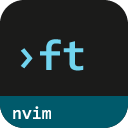
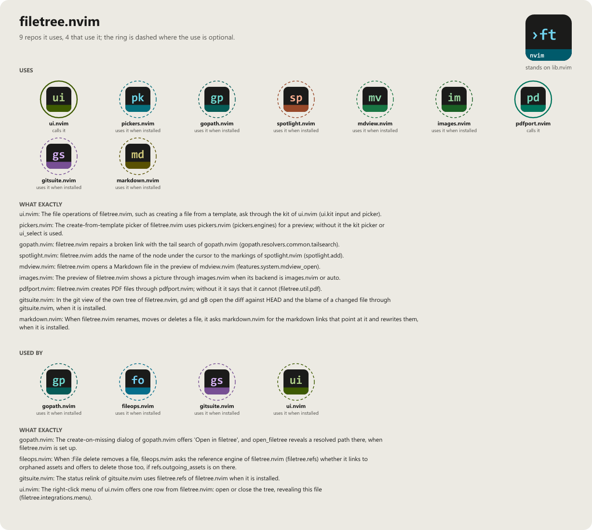

> **Beta stage — active development.** This repository is past its first shape and in
> active use, but the surface is not frozen: breaking changes are still possible. Pin a
> commit or tag if you depend on it.

# filetree.nvim

```
  ███████╗██╗██╗     ███████╗████████╗██████╗ ███████╗███████╗
  ██╔════╝██║██║     ██╔════╝╚══██╔══╝██╔══██╗██╔════╝██╔════╝
  █████╗  ██║██║     █████╗     ██║   ██████╔╝█████╗  █████╗
  ██╔══╝  ██║██║     ██╔══╝     ██║   ██╔══██╗██╔══╝  ██╔══╝
  ██║     ██║███████╗███████╗   ██║   ██║  ██║███████╗███████╗
  ╚═╝     ╚═╝╚══════╝╚══════╝   ╚═╝   ╚═╝  ╚═╝╚══════╝╚══════╝
                              .nvim
```

[](LICENSE)
[](https://neovim.io)
[](https://www.lua.org)

[](https://wkdsteve.github.io/wkd/p/filetree/)

> Part of the [wkd](https://wkdsteve.github.io/wkd/) family — see this plugin's [page](https://wkdsteve.github.io/wkd/p/filetree/) on the site.

**Adapter-agnostic filetree features for Neovim.** Works with neo-tree.nvim,
nvim-tree.lua, netrw, oil.nvim and mini.files through one adapter interface, so
changing tree plugins costs you the plugin, not the workflow you built on top
of it.

**And a tree of its own.** `adapter = "native"` is filetree.nvim's own tree, with
no tree plugin behind it: lazy, one read per folder shared by every tab, the
cursor bound to its entry. Its window shows more than files: open buffers, git
changes, document symbols and diagnostics are views of it, one key or one click
apart. It is new and chosen by name; see
[the native adapter](docs/FEATURES/BACKENDS.md#native-adapter-the-own-tree).

**Screenshots, readable.** `<CR>` on an image opens an
[image viewer](docs/FEATURES/UI.md#image-viewer): zoom into the corner that
matters (Alt + wheel at the pointer), drag the picture around, cut a part into
a window of its own at full resolution, and save it (`gs`) or copy it to the
clipboard (`gy`). Needs [images.nvim](https://github.com/WKDSteve/images.nvim),
an image-capable terminal (WezTerm, iTerm2, Konsole) and ImageMagick — see
[Requirements](docs/installation.md#requirements).

---

## Documentation

Start at [docs/README.md](docs/README.md) — what's where, and which question
each page answers.

### The Basics

- [Requirements](docs/installation.md#requirements) — Neovim version, required and optional plugins.
- [Installation](docs/installation.md) — every plugin manager.
- [Quickstart](docs/quickstart.md) — the first thing to run after installing.

### Configuration & Commands

- [What you get with the defaults](docs/what-you-get.md) — the things worth knowing on day one.
- [All options](docs/configuration.md) — every `setup()` option and its default.
- [Commands](docs/commands.md) / [Bindings cheatsheet](docs/BINDINGS.md) — the `:Filetree` command tree and every keymap/autocommand at a glance.
- [Keymaps](docs/keymaps.md) — the tree-buffer keys, and how to remap or disable one.
- [Lua API](docs/api.md) — the public API, and how to register a custom adapter.

### The Rest

- [Features](docs/FEATURES/README.md) — every feature by category, the default-disabled ones, and deep dives into the core.
- [Around it](docs/around-it.md) — how this plugin's scope differs from its siblings in the collection.
- [Menu integration](docs/menu.md) — the context menu, and using filetree.nvim's actions in your own.
- [Integrations](docs/integrations.md) — the same menu entries, exposed for your own trigger.
- [Workflow](docs/WORKFLOW.md) — how the features combine once several are on at the same time.
- [Health check](docs/troubleshooting.md) — what `:checkhealth filetree` reports, and what to do about a warning.
- [Contributing](docs/CONTRIBUTING.md) — ground rules, project layout, and how to add an adapter or a feature.
- [Feedback](https://github.com/WKDSteve/filetree.nvim/issues) — bugs, features, usage questions; broader discussion fits the [discussions board](https://github.com/WKDSteve/filetree.nvim/discussions).

`:help filetree` is the same reference inside the editor.

---

## License

MIT — see [LICENSE](LICENSE).

<!-- connections:begin (written by the app-icons tool of the workshop; change integrations.json there, not this block) -->
## Connections



**Uses**

- [gitsuite.nvim](https://github.com/WKDSteve/gitsuite.nvim): In the git view of the own tree of filetree.nvim, `gd` and `gB` open the diff against HEAD and the blame of a changed file through gitsuite.nvim, when it is installed. ([picture](assets/graphs/pair/filetree.nvim--gitsuite.nvim.png))
- [gopath.nvim](https://github.com/WKDSteve/gopath.nvim): filetree.nvim repairs a broken link with the tail search of gopath.nvim (`gopath.resolvers.common.tailsearch`). ([picture](assets/graphs/pair/filetree.nvim--gopath.nvim.png))
- [images.nvim](https://github.com/WKDSteve/images.nvim): The preview of filetree.nvim shows a picture through images.nvim when its backend is `images.nvim` or `auto`. ([picture](assets/graphs/pair/filetree.nvim--images.nvim.png))
- [markdown.nvim](https://github.com/WKDSteve/markdown.nvim): When filetree.nvim renames, moves or deletes a file, it asks markdown.nvim for the markdown links that point at it and rewrites them, when it is installed. ([picture](assets/graphs/pair/filetree.nvim--markdown.nvim.png))
- [mdview.nvim](https://github.com/WKDSteve/mdview.nvim): filetree.nvim opens a Markdown file in the preview of mdview.nvim (`features.system.mdview_open`). ([picture](assets/graphs/pair/filetree.nvim--mdview.nvim.png))
- [pdfport.nvim](https://github.com/WKDSteve/pdfport.nvim): filetree.nvim creates PDF files through pdfport.nvim; without it it says that it cannot (`filetree.util.pdf`). ([picture](assets/graphs/pair/filetree.nvim--pdfport.nvim.png))
- [pickers.nvim](https://github.com/WKDSteve/pickers.nvim): The create-from-template picker of filetree.nvim uses pickers.nvim (`pickers.engines`) for a preview; without it the kit picker or `ui_select` is used. ([picture](assets/graphs/pair/filetree.nvim--pickers.nvim.png))
- [spotlight.nvim](https://github.com/WKDSteve/spotlight.nvim): filetree.nvim adds the name of the node under the cursor to the markings of spotlight.nvim (`spotlight.add`). ([picture](assets/graphs/pair/filetree.nvim--spotlight.nvim.png))
- [ui.nvim](https://github.com/WKDSteve/ui.nvim): The file operations of filetree.nvim, such as creating a file from a template, ask through the kit of ui.nvim (`ui.kit` input and picker). ([picture](assets/graphs/pair/filetree.nvim--ui.nvim.png))
- [lib.nvim](https://github.com/WKDSteve/lib.nvim): the shared base of the plugins.

**Used by**

- [fileops.nvim](https://github.com/WKDSteve/fileops.nvim): When `:File delete` removes a file, fileops.nvim asks the reference engine of filetree.nvim (`filetree.refs`) whether it links to orphaned assets and offers to delete those too, if `refs.outgoing_assets` is on there. ([picture](assets/graphs/pair/fileops.nvim--filetree.nvim.png))
- [gitsuite.nvim](https://github.com/WKDSteve/gitsuite.nvim): The status relink of gitsuite.nvim uses `filetree.refs` of filetree.nvim when it is installed. ([picture](assets/graphs/pair/gitsuite.nvim--filetree.nvim.png))
- [gopath.nvim](https://github.com/WKDSteve/gopath.nvim): The create-on-missing dialog of gopath.nvim offers 'Open in filetree', and `open_filetree` reveals a resolved path there, when filetree.nvim is set up. ([picture](assets/graphs/pair/gopath.nvim--filetree.nvim.png))
- [ui.nvim](https://github.com/WKDSteve/ui.nvim): The right-click menu of ui.nvim offers one row from filetree.nvim: open or close the tree, revealing this file (`filetree.integrations.menu`). ([picture](assets/graphs/pair/ui.nvim--filetree.nvim.png))
<!-- connections:end -->
