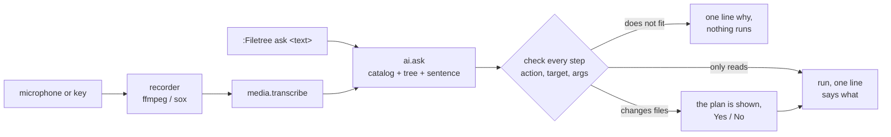

# Words to tree actions (`native.ai`)

Say or type what you want the tree to do — "open init.lua as a vsplit", "set
the cwd to lib.nvim" — and the own tree (`adapter = "native"`) turns the
sentence into its own actions. **Off by default.** It needs
[ai.nvim](https://github.com/WKDSteve/ai.nvim); speaking also needs a recorder
(ffmpeg or sox) and [media.nvim](https://github.com/WKDSteve/media.nvim) with a
whisper engine. Without ai.nvim there is no key, no button and no error.

```lua
require("filetree").setup({
  adapter = "native",
  native = {
    ai = {
      enabled = false,           -- turn it on
      provider = nil,            -- an ai.nvim provider ("ollama" keeps everything local); nil: ai.nvim's choice
      model = nil,               -- a model of that provider; nil: ai.nvim's default
      timeout_ms = 60000,        -- how long to wait for the answer
      max_paths = 400,           -- paths of the tree the model is told at most
      keys = { ask = "<leader>at", listen = "<leader>aT" }, -- false: no key
      button = true,             -- the microphone in the view bar
      record = {
        tool = "auto",           -- "auto" | "ffmpeg" | "sox"
        device = nil,            -- input device; ffmpeg on Windows needs one (sox does not)
        silence = 2,             -- seconds of silence that end the recording
        max_seconds = 30,        -- the longest recording
      },
    },
  },
})
```

## Using it

| Where | What |
| --- | --- |
| `:Filetree ask <text>` | the sentence becomes actions of the tree in this tab; without text it asks for one. Needs no audio tool |
| `<leader>at` in the tree | asks for a sentence, the same way |
| `<leader>aT` in the tree, or the microphone at the right end of the view bar | records until a pause of `silence` seconds; pressed or clicked again, it stops at once. The recording goes through `media.transcribe` and then the same way as a typed sentence. Only there when a recorder and media.nvim are |

What happened is said in one line: `ai: open_variants.vsplit lua/init.lua`. When
nothing in the tree fits, or the answer cannot be used, one line says why and
nothing runs.

## How a sentence becomes actions



The model is told three things and nothing else:

- **The catalog**: the actions of the view's [action table](BACKENDS.md#one-action-table),
  each with its name, description, arguments, requirements and whether it
  changes files. A filetree feature's key is named after the feature and the
  action (`open_variants.vsplit`, `trash.trash`, `cwd_mode.lock_here`), so the
  name does not change with the key. An action registered with `ai = false`
  is left out, and so are `shell_run`, `quickpick`, `tree_toggle` and the
  context menu.
- **The tree**: its root, the cwd, the view, the entry under the cursor, the
  marked entries and the paths the tree already knows (the rows and the folders
  it has read; at most `max_paths`, names only). **Never the content of a
  file**, and none of ai.nvim's own context (buffer, selection, diagnostics).
- **The sentence.**

The answer has to be a list of steps, `[{ "action", "target", "args" }]`. It is
untrusted input, and every field is checked before anything runs:

| Refused | One line, for example |
| --- | --- |
| an action that is not in the catalog | `step 1: no action "rm_rf" in this tree` |
| a target with `..`, a home folder, or outside the root | `step 1: "../x" goes above the root` |
| a path the tree does not know | `step 1: "nope.lua" is not an entry the tree knows` |
| an action that does not apply there (`needs`) | `step 1: notes.archive: needs a file` |
| an argument the action does not declare, or a value outside its list | `step 1: argument where of notes.archive is one of year/month, not "…"` |
| more than 5 steps; a step that changes files together with other steps | `the plan has 100 steps, at most 5 run at a time` |
| a step that changes the root of the tree itself | `step 1: trash.trash on the root of the tree is not done this way` |
| no JSON, or no list of steps | `the answer has no plan in it` |

A name that is not a path ("init", "the readme") is looked up among the known
paths; when several fit, a list asks which one. While entries are marked, an
action acts on the marked ones: a step that names another entry is refused
instead.

## Actions that change files

A step that changes files runs on its own, never in a plan of several (a step
before it could move the cursor or the marks, and the question would name other
entries than the ones it acts on). It is **always** shown first, with the
entries it acts on (all marked ones, while there are marks), and runs only on
Yes — whatever `confirm` options the features have, and whatever the answer
says. The feature's own question (the trash's, for one) follows as it does by
hand.

Which actions run without the question: the tree's own keys; another plugin's
action or a source's only when it says `mutates = false` (one that says nothing
asks); of the features only those on a list of reading ones (opening in the
editor, moving the root or the cwd, copying paths, marks, filter, search, the
preview float, node info, ...). That list lives next to the action table
(`filetree.native.action.features`, `READ_ONLY`), which writes on every feature
key which feature and action it is and whether it changes files (`feature`,
`feature_action`, `mutates`); every other feature
key, also one that is new, asks first, and so does one that starts another
program (a PDF in the system viewer, the browser preview of mdview, a file
`<CR>` hands to the system).

## Privacy and policy

Only names and paths leave the editor. Which provider answers is ai.nvim's
decision under its policy (`ai.policy()`, `policy.allowed`); this feature never
asks for an exception to it, and a `provider` set here that the policy does not
allow is refused with one line. With `provider = "ollama"` nothing leaves the
machine.

## `:checkhealth filetree`

With the own tree active, the native block says whether the feature is on,
whether ai.nvim is installed, what the policy allows, and whether speaking
works, or what it misses (a recorder, media.nvim, a whisper engine).
