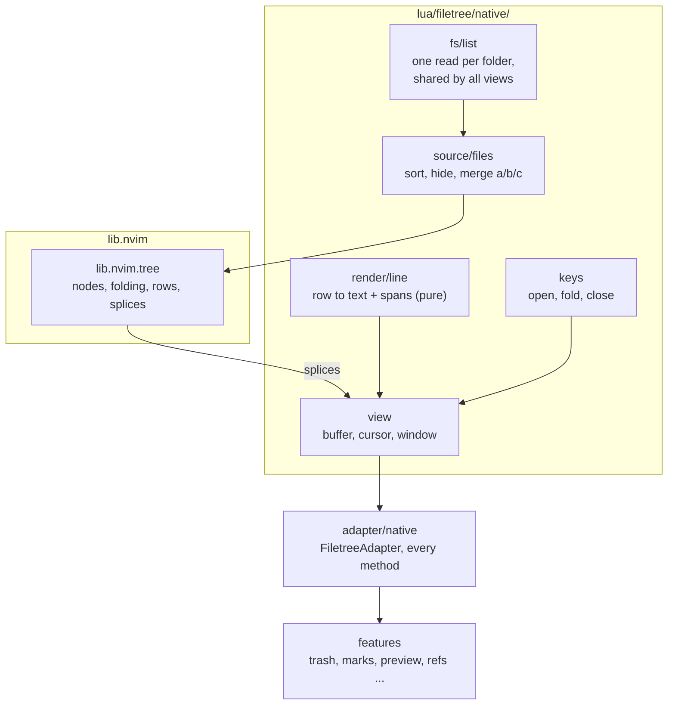
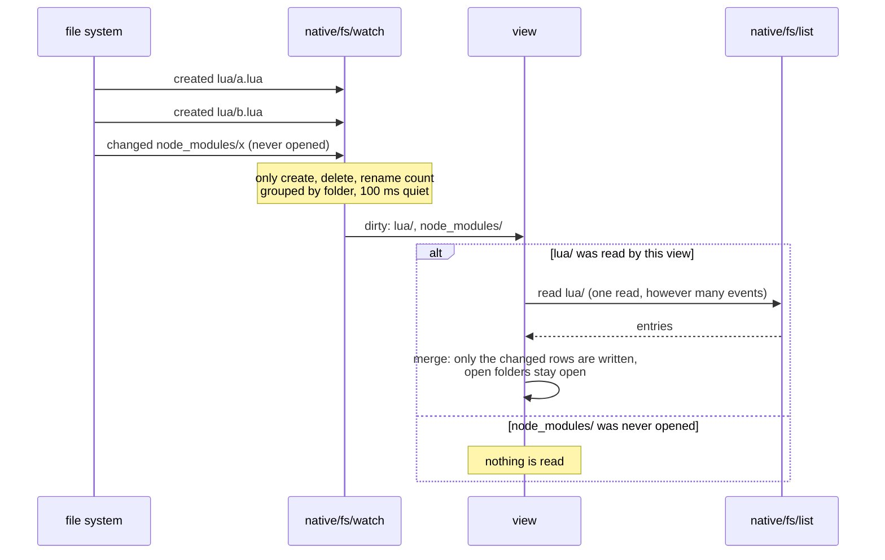
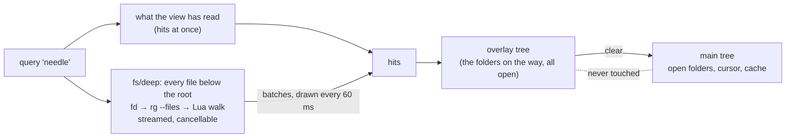

# Backends

filetree.nvim's own tree and the five tree plugins it can drive through the
[adapter abstraction](CORE.md#backend-adapter-abstraction), plus the
plumbing that exists specifically because one of them (neo-tree, on
Windows/WSL) leaks OS-level file handles.

## native adapter (the own tree)

`adapter = "native"`. filetree.nvim's own tree: no tree plugin behind it, only
[lib.nvim](https://github.com/WKDSteve/lib.nvim). It is new and chosen by name;
`adapter = "auto"` never picks it, so nothing changes for an existing setup.

> **Status.** The tree, its window and the whole adapter contract are there, the
> features run on it, it follows the disk by itself and draws the badges of
> registered decorators, it searches below folders it never opened, every
> key goes through one action table, and the window shows more than files:
> buffers, git changes, document symbols and diagnostics are views of it.
> Treat it as a trial backend until it has replaced neo-tree in daily use.

```lua
require("filetree").setup({
  adapter = "native",
  native = {
    position = "left",        -- "left" | "right" | "top" | "bottom" | "float" | "current"
    width = 32,               -- of a side tree
    height = 15,              -- of a tree at the top or bottom
    hijack_netrw = true,      -- a folder opened as a buffer (nvim <dir>, :edit <dir>) shows the tree there
    group_empty_dirs = true,  -- a chain of folders holding one folder each is one line: a/b/c/
    icons = true,             -- file and folder icons; drawn only with a Nerd Font declared
    max_entries = 20000,      -- entries shown per folder; a last line says how many more (0 = no limit)
    watch = true,             -- follow changes on disk and read only the folders that changed
    search_max = 1000,        -- hits a search shows at most; a last line says how many more
    view_bar = true,          -- the views as tabs in the winbar of the tree window
    views = nil,              -- which views there are; nil: files, the tree's sources, registered ones
  },
})
```

### How it is built



- **Lazy.** A folder is read when it is opened (`uv.fs_scandir`), once, into a
  cache every tree view shares: a second tab with a tree reads nothing again.
- **Changes are splices.** Opening a folder, a refresh, a new file: the model
  answers which rows changed, and exactly those buffer lines are written. A
  refresh keeps every open folder open.
- **The cursor belongs to a node.** Lines that come and go above it move it
  along; it does not jump.
- **The buffer line is indent, expander, icon and name.** Highlights are drawn
  for the lines on screen only (a decoration provider with ephemeral extmarks),
  nothing is stored in the buffer for them.
- **State per tab.** What is open, the cursor, the sort order and the position
  belong to the view of a tab and survive closing its window.

### Following the disk

While its window is shown, the tree is told which folder changed and reads
exactly that one again. `R` and `:Filetree refresh` are for the cases a watcher
cannot see (a network drive), not for everyday use.



- **Handles.** One recursive handle per root on Windows and macOS, one per
  folder the tree has read elsewhere (libuv cannot watch recursively there).
  Views of the same root share them; they close with the last window that shows
  the tree, and a tree that is opened again catches up in the background.
- **One read per folder.** At most one read of a folder runs; changes that
  arrive meanwhile are answered by one more read after it. Sixty files written
  in a row cost one read in the spec.
- **A storm is held back.** A folder with more than 200 events a second is
  reported once, two seconds after it went quiet.
- **`User FiletreeFsChanged`** fires with `data.dirs` for whoever else wants to
  know; `git_status` re-queries on it.
- With the own watcher on, the `file_watcher` feature stands down on this
  backend (its answer to any event is a refresh of the whole tree).

A limit where handles are per folder (Linux): a closed folder is not watched, so
a change inside it shows when it is opened, and a plain closed folder that
gains its only subfolder is not merged into one line until its parent is read
again.

### Search

The `filter` feature (`/` and `:Filetree filter`) searches with this tree: the
hits are a tree of their own, laid over the main tree, and they come from every
folder below the root, opened or not.



- **Matching.** Every word of the query has to occur in the path below the
  root; lower case matches both cases, one upper-case letter makes it exact.
- **The main tree is never touched.** What is open there, the cursor, what was
  read: all of it stays, and clearing the search shows it as it was. The tree
  underneath keeps following the disk meanwhile.
- **Only the last search reaches the screen.** A search replaced or cleared
  while it lists stops its listing, and a late answer of it is dropped.
- **Limits.** At most `search_max` hits are shown, a last line says how many
  more there are. `.git` is never listed; `fd` and `rg` leave out what
  `.gitignore` names, the Lua walk the names of the ignore list. A new root
  (`set_root`) ends a search.

### Views and sources

The tree window shows one **view** at a time: the files, or the nodes of
registered [sources](../api.md#a-source). The tree brings four sources itself;
another plugin's source (tests, tasks) is a view the same way.

```
 view bar (winbar, clickable; " and ! cycle)
 ┌────────────────────────────────────┐
 │ Files  Buffers  Git 3  Sym [!]  Dia│   a count: nodes of the view that carry a
 ├────────────────────────────────────┤   status. [!]: the source cannot load now
 │ ▾ Git                              │
 │   ▾ Staged                      1  │
 │       lua/a.lua                 M  │
 │   ▾ Changes                     2  │
 │       lua/a.lua                 M  │
 │       README.md                 M  │
 └────────────────────────────────────┘
```

| View | Shows | Live on | Its own keys |
| --- | --- | --- | --- |
| `files` | the directory tree | the watcher | everything above and below |
| `buffers` | listed file buffers (relative to the root), unnamed buffers, terminals | buffer events | `dd` deletes the buffer (a modified one is kept and named) |
| `git` | the changed files of the repository the root lies in, as `Conflicts` / `Staged` / `Changes` / `Untracked` | a write, focus, a file operation, files that came or went | `ga` stage, `gu` unstage; with gitsuite.nvim `gd` diff against HEAD, `gB` blame |
| `symbols` | the LSP document symbols of the editor buffer | another editor buffer, an edit; its cursor follows the editor's | `<CR>` goes to the symbol |
| `diagnostics` | every diagnostic the editor holds, by folder and file, the worst first | `DiagnosticChanged` | `<CR>` goes to the place |

- **Switching touches nothing but the lines.** The window, its position and its
  width stay; the files come back as they were left; every view keeps its own
  cursor and its open nodes.
- **A node with a path is a file in every view.** A buffer, a changed file, a
  file with diagnostics: trash, rename, path copies, the preview and every path
  [decorator](../api.md#a-decorator) work on it without another line. A node
  without one (a symbol, a terminal, a single diagnostic, a group) is no entry
  for those features.
- **A source costs nothing while it is not shown.** It is asked when its view
  is shown, followed while the window is on screen, and asked again when the
  window or the view comes back.
- **A source that cannot load** (no language server, no git) keeps its tab,
  dimmed with `[!]`; its view is one line that says why, and comes alive by
  itself when the source can load.
- **Sections.** `native.views` lists the views; one with several sources shows
  them under each other, each under its own head:

  ```lua
  native = {
    views = {
      { "files" },
      { name = "work", "buffers", "git" }, -- one view, two sections
      { "symbols" },
      { "diagnostics" },
    },
  }
  ```

  Without `views`: the files, the tree's own sources, then every source another
  plugin registered. The files cannot be a section next to other sources yet
  (that section says so).
- **`source_switcher`** ([navigation](NAVIGATION.md)) drives the views here:
  `:Filetree source [<name>|next|prev|pick]`, its pick key and its API.
- **Keys of the directory tree** that make no sense elsewhere (`H`, the search)
  step back in another view. A feature key that changes the root (`-`) changes
  the root of the view: the git view then shows the repository of that folder.
- **Feature keys** are bound on the one tree buffer for all views:

  | Cursor on | A feature key |
  | --- | --- |
  | a node with a path (a buffer, a changed file, a file with diagnostics) | acts on that file as in the files view: copy its path, rename, move, trash, open, info ... The view follows what happened to it. |
  | a node without one (the head of a section, a group, a symbol) | says that there is nothing to act on (`No node under cursor`), asks nothing, changes nothing |

  Three act on the listing of the files and say so here instead of looking as
  if they had worked: `/` (`filter`) opens no filter line (`nothing to filter in
  the view "buffers"`), the sort keys sort the files and say that the view
  keeps its own order (the files show it when they come back), and a create
  (`a`) on a line without a folder asks with the folder it takes in the prompt
  (`Create in ./`, the root of the view).

### The tree buffer

Filetype `filetree`, `buftype=nofile`, unlisted; `b:filetree_view` (the name of
the view on screen, `"files"` at first) is set before the `FileType` event, and
`User FiletreeView` fires with `{ buf, view }` when another view is shown. A side tree's window has `winfixbuf`,
`winfixwidth`, `foldmethod=manual` and `nofoldenable` (a tree has nothing to
fold, and an inherited `foldexpr` would be evaluated once per line and change).
The first line is the root folder; it is the label of the tree, not an entry
(`get_visible_nodes` leaves it out, the cursor on it still answers the root as
the current node).

### Its own keys

Only what makes a tree a tree; every other key is a feature's and is bound on
the same buffer.

| Key | Action |
| --- | --- |
| `<CR>`, `o`, `<2-LeftMouse>` | open the file in an editor window, or open/close the folder |
| `l` | open the folder or file; on an open folder, go to its first entry |
| `h` | close the folder, or go to the parent folder |
| `C` | close the folder the entry lies in |
| `z` | close every folder |
| `R` | read the folders again, or ask the sources of the view again |
| `"`, `!` | show the next, the previous view |
| `H` | show or hide the names of the ignore list |
| `-` | show the parent folder as the root |
| `sw` | open the file in a window you pick |
| `q` | close the tree |

### One action table

Every key of the tree buffer is an entry of the view's action table
(`lua/filetree/native/action/`): the tree's own keys above, the keys the
features bound, the actions other plugins registered
([api](../api.md#an-action)) and those of the view's source. The `?` cheatsheet
opens on the page **here** (what applies to the node under the cursor, with the
key that reaches it), the context menu lists the same, and
`:Filetree action <name>` runs one by name.

```
 key d on ...            node                  runs
 ───────────────────────────────────────────────────────────────────────
 files                   file                  trash (a feature)
 files                   the "N more" line     "d: needs a file or folder"
 a test view (source)    spec file             diff (the source's action ranks first)
```

When several actions claim a key, the first that applies runs: the source's,
then the higher `priority`, then a feature before another plugin's action before
the tree's own. When none applies, one line says why. A key the user mapped on
the tree buffer (`adapter_keymaps`) or another plugin mapped stays theirs.

### Windows and the netrw replacement

`top` and `bottom` open the tree as a full-width split (`height`). With
`hijack_netrw` (on by default, only with `adapter = "native"`), a folder opened
as a buffer, `nvim <dir>` or `:edit <dir>`, shows the tree in that window,
rooted at the folder; `-` goes up, `<CR>` on a file opens it in the same window.

### After a file operation

Every file operation of filetree.nvim ends with `User FiletreeChanged`
(`{ op, from, to }`, [api](../api.md#when-files-changed)); the own tree reads the
folders `from` and `to` lie in and nothing else, also with `watch = false`. A
target in a folder the operation itself made (`move x new/dir/`) reads the
nearest folder above it that the tree shows, so the new folder appears. No
feature asks the own tree for a refresh of everything afterwards (the other
backends, which know nothing of the event, still get one).

A file never opens in the tree's own window: it goes to the window you came
from, else to another editor window, else to a new one beside the tree. Closing
the tree when it is the only window of its tab leaves the window with an empty
buffer instead of closing the tab. A docked tree that was the only window for a
moment (the last editor window closed, `layout_guard` opened a new one) gets
the width it had before back, not half the screen.

### The features on it

Every feature that is on by default is driven on the own tree by a spec that
presses its key, clicks, or raises the event it reacts to, on a real tree
window, and reads the result (`TESTS/native_features_spec.lua` and the
`TESTS/native_drive_*_spec.lua` files, one per group: paths, file operations,
search and system, ui, navigation and infrastructure, and the views that are
not the files). What leaves the editor there (another plugin, a program of the
system, the trash) is a stand-in.

### What it does that the other backends do not

- `get_expanded_paths` / `expand_paths`: the first backend with them, so
  [session](INTEGRATIONS.md) restores open folders here.
- Folders show what lies below them: with `git_status` a closed folder carries the
  worst git state inside it, and any registered
  [decorator](../api.md#a-decorator) with `roll_up` does the same.
- No handles to guard: `handle_guard`, `tree_integrity`, `sidebar_guard` and the
  neo-tree patch of `watcher_quarantine` do not apply and stay inert.

### Measured

On the development machine (Windows 11, NVMe), by `TESTS/native_view_spec.lua`:

| | |
| --- | --- |
| open the tree again (its folders are cached) | about 2 ms |
| open a new tree (read the root, build, buffer, window) | about 15 ms |
| open a folder with 10 000 entries (read, sort, model, 10 000 buffer lines) | 50 to 80 ms |
| close and open that folder again from the model | about 30 ms |
| draw the highlights of 50 visible lines | under 1 ms |
| a status change of one node with 10 000 lines in the tree (`native_perf_spec.lua`) | about 0.05 ms, no buffer write |
| five new files a second in a folder of 2000 entries, 6 s | one read of it at a time, each answer (merge, write) 20 to 35 ms |

A folder is read and written in one piece, not in slices: the 10 000 entries
above block once for those 50 to 80 ms. Measured by hand for the decision: 50 000
entries take about 250 ms without a limit and about 135 ms with the default
`max_entries = 20000`, which is what bounds the model and the buffer. A folder
that is cut ends in a line that says how many entries are not shown.

## neo-tree adapter

`adapter = "neotree"`. The most complete adapter — the only one with a
native "follow cwd"
feature (`bind_to_cwd`/`follow_current_file`) that `cwd_sync.reveal` should
defer to, and libuv directory watchers that motivate `handle_guard`/
`watcher_quarantine` below. Resolves the current node via `lib.nvim.neotree.node`.

Resolves a buffer line back to the node drawn on it (`get_node_at_line`)
through the nui tree's own line mapping, which is what lets git status, LSP
diagnostics, file sizes and the cut/copy clipboard marker decorate this
backend — see [Line-resolved decorations](#line-resolved-decorations).

Every adapter function funnels through neo-tree's own **per-tab** state —
neo-tree keeps a separate state per tabpage, and its `manager.get_state()`
defaults to whichever tab is current *when it is called*. Two related but
distinct problems fall out of that, resolved two different ways:

- **A tree resolved with nothing more specific to go on** (`get_bufnr`,
  `get_winid`, `get_current_node`, `expand_node`/`collapse_node`, …) goes
  through an internal `get_state()` helper that prefers the tab that is
  actually current, then falls back to a small cache of the last tab a live
  window was resolved on, then as a last resort probes every open tab. The
  cache exists for a redraw that happens to run while a *different, treeless*
  tab is current (neo-tree's own async render or a git-status/fs-watcher job
  landing while another tab is current) — without it, that call would resolve
  an empty per-tab state and silently no-op, leaving whatever the real redraw
  just wiped (the symlink sign, most visibly) undrawn until the tree's own tab
  was focused again. Preferring the current tab first, rather than the cache,
  matters once a **second** tree is simultaneously live on a second tab: a
  cache that always won unconditionally would keep resolving the first tab
  that got cached, everywhere, even from inside the second tree's own window.
  The last-resort probe checks liveness with neo-tree's own `manager.get_state`,
  which lazily creates and *permanently registers* an empty state for any
  tabid that never had one — left alone, that leaks a ghost `all_states` entry
  per background tab this probe ever glances at, which can later make
  neo-tree's own `opened_buffers_changed` abort its whole iteration early on a
  stray disposed-window reference, silently breaking the narrow-redraw resync
  below for *other, real* trees. The probe tells "never had a tracked state"
  (safe to dispose right back after checking) apart from "already had one
  before this probe ran" (left alone, even if not currently live) via
  `manager._get_all_states()`, and only ever disposes the former.

  `TESTS/neotree_redraw_hook.lua` pins this against a real neo-tree: it forces
  the last-resort probe to run over a tab with no tracked state and asserts
  `manager._get_all_states()` shows no leftover entry for it afterward.
- **A caller that already has a concrete tree bufnr in hand** — `get_node_at_line`,
  and the bufnr the adapter's `on_render` bridge hands each redraw callback —
  resolves straight from that bufnr's own window (`state_for_bufnr`) instead,
  which is unambiguous even with two trees simultaneously live: neo-tree
  itself fires its `AFTER_RENDER` event with the real state for whichever
  tree just (re)rendered, and the adapter reduces that to a bufnr and passes
  it through, so link_marker/marks decorate the SPECIFIC tree that just
  redrew rather than re-deriving an ambient "current tab" bufnr that could
  silently be a different, unrelated tree.

The `on_render` bridge itself covers two DIFFERENT neo-tree redraw paths, only
one of which fires a real event. A full rescan (`refresh()`, `navigate()`, the
first render after `:Neotree show`) ends in `ui/renderer.lua`'s `show_nodes`,
which fires `AFTER_RENDER`. But neo-tree also redraws WITHOUT rescanning —
`renderer.redraw(state)`, called from a dozen places, most notably
`sources/manager.lua`'s `opened_buffers_changed` (wired to
`enable_opened_markers`/`enable_modified_markers`, both default-on: opening or
closing a buffer **anywhere in the session** redraws **every tracked per-tab
tree**, including background tabs) — and that path never reaches `show_nodes`,
so it never fires `AFTER_RENDER` either. It still replaces the buffer's
content (`state.tree:render()`), which does not carry extmarks over, so a
background tab's symlink sign or mark checkmark could go silently undrawn
until that tab's own tree got a real `AFTER_RENDER` of its own. The bridge
closes this by also monkeypatching `renderer.redraw` itself
(`install_redraw_hook`) — reached by *most* callers through a plain field
lookup on the shared module table, so the patch is visible to them regardless
of load order — rather than a parallel autocmd guessing at neo-tree's own
200ms debounce from the outside; see that function's doc comment for the
reasoning. `TESTS/adapter_lines.lua`'s `run_neotree_opened_buffers_redraw_check`
pins this against a real neo-tree, firing the real buffer-add/-delete
autocmds rather than a synthetic `AFTER_RENDER`.

**One caller does NOT reach `renderer.redraw` through a field lookup:**
neo-tree's own `sources/filesystem/commands.lua` does
`local redraw = renderer.redraw` at its OWN module-load time — a plain Lua
upvalue, captured once, not re-read on every call. `M.copy_to_clipboard` and
`M.cut_to_clipboard` (bound by default to `y`/`x`) call *that* captured local
to redraw after marking a node, never a fresh field read — so patching the
`renderer.redraw` *field* later cannot fix them if that module already
captured its own copy first. And it is required *eagerly*, for every
configured source, from inside neo-tree's own `setup()` — which, for a
commonly lazy-loaded neo-tree.nvim (`cmd = "Neotree"` / `ft = "neo-tree"`),
only runs on the user's first `:Neotree` invocation, i.e. potentially well
after filetree.nvim's own `setup()` already tried to install this hook.

To win that race, the adapter also installs a `package.preload` entry for
`neo-tree.ui.renderer` (`hoist_redraw_hook`, called unconditionally at this
adapter module's own load time, not gated behind any feature's `setup()`) —
Lua's own hook for "run this the first time, and only the first time, anyone
requires this module name". That makes the very first
`require("neo-tree.ui.renderer")` from *anyone*, including from inside
neo-tree's own `setup()`, return an already-patched module, before
`commands.lua`'s own `local redraw = renderer.redraw` can run. This is
reliable as long as `filetree.adapter.neotree` is `require`d (i.e.
`filetree.setup()` runs, with `adapter = "neotree"` or `"auto"`) before
anything else has ever required `neo-tree.ui.renderer` — true for the
ordinary "neither plugin lazy past VimEnter" and "both lazy on the same
`:Neotree` trigger, filetree's spec loads first" cases.

The hoist never poisons a neo-tree that is not installed *yet*. LuaJIT's
`require` parks a "loading" sentinel in `package.loaded` before it runs a
loader and does not clear it when the loader throws, so a preload loader that
threw for a missing module would have failed every later
`require("neo-tree.ui.renderer")` — neo-tree's own, once it does load — with
"loop or previous error loading module" for the rest of the session. The
`on_render` install retries hit exactly that path (they `require` the renderer
while neo-tree is still absent). The loader therefore clears the sentinel and
re-arms itself before it re-raises the ordinary "module not found".

**Lazy-loaded neo-tree and `on_render`.** `on_render` (marks, link_marker)
retries the hook install in the background for about three seconds
(20 × 150 ms). A neo-tree.nvim that is first opened after that — a
`cmd = "Neotree"` / `ft = "neo-tree"` spec used minutes into the session —
is not given up on: the subscription then waits for the first `neo-tree`
buffer (`FileType`, which cannot exist before neo-tree is loaded), installs
the `AFTER_RENDER` subscription and the `renderer.redraw` hook at that point,
and calls the subscriber once with that buffer. The autocmd is deleted again
after a successful install and when the subscription is cancelled.
`TESTS/nav_switch_toggle.lua` pins both (against a stubbed neo-tree, with the
retry window shortened through the private `M._retry`).

**Disclosed limitation:** if the user's own config calls
`require("neo-tree").setup()` (which itself eagerly requires
`commands.lua`, which requires `renderer`) *before* filetree.nvim's own
`setup()` ever runs, hoisting is no longer possible — `commands.lua` has
already captured the original `renderer.redraw`. The field-patch fallback
still installs and still covers every other narrow-redraw call site (the
ones reached by field lookup), but `copy_to_clipboard`/`cut_to_clipboard`
specifically will not notify this bridge for that session, and their
decorations (marks, symlink signs) may go stale after a copy/cut until the
next full rescan. Loading filetree.nvim before neo-tree.nvim's own `setup()`
call avoids this entirely. `TESTS/neotree_redraw_hook.lua` pins the
hoisted-and-winning case against real `copy_to_clipboard`/`cut_to_clipboard`
calls, in the same relative load order (filetree first, then neo-tree's
`setup()`) a lazily-loaded neo-tree.nvim gives in practice.

**Coalescing filetree's own redraw triggers (`M.redraw_soon`).** The bridge
above keeps filetree's own decorations in sync with neo-tree's redraws; it
does not stop filetree's own code from *adding* redraws. `collapse_node` /
`expand_node` each fire an immediate `renderer.redraw` right after mutating
the tree structure, and `opened_sync` independently fires its own debounced
`adapter.redraw()` on buffer add/remove/show/hide — landing close together
(e.g. collapsing a folder that also changes which buffers are visible)
compounds into several narrow re-renders in a short window. Since neo-tree's
native `enable_modified_markers`/`enable_opened_markers` icons are
recomputed fresh on every one of those passes, a burst reads on screen as a
brief flicker of the icon (most visibly: appearing to sit on the wrong node
for a render or two before settling — see the collapse-flicker note on
`M.collapse_node`'s own doc comment). `M.redraw_soon()` is a small (30ms)
coalescing window (via the same `lib.nvim.debounce` used elsewhere in this
codebase) for a caller whose trigger isn't already synchronously tied to one
structural mutation AND isn't already debounced against itself.
`collapse_node`/`expand_node` stay on the immediate, uncoalesced path —
deferring their own redraw would risk `renderer.focus_node` landing on a
stale line. `opened_sync` was the original motivating caller but, on
inspection, turned out not to need it: its own debounce already reduces a
burst of buffer events to exactly one call, so wrapping that single call in
`redraw_soon`'s separate debounce had nothing left to coalesce with and only
added latency (~90ms instead of ~60ms by default) — it now calls `redraw()`
directly instead. No production call site uses `redraw_soon` today; it is
kept as a primitive for a future caller whose own trigger genuinely fires
more than once per structural change with no debounce of its own.
**Disclosed limitation:** even when used, this only reduces filetree's *own*
contribution to a redraw burst. It cannot coordinate with neo-tree's own
internal redraw timing (`opened_buffers_changed`'s own debounce,
watcher-driven redraws, the native marker recompute itself) — those live
entirely inside the external neo-tree.nvim dependency. A residual flicker
sourced purely from neo-tree's own internals can still occur.

- **Module:** [`adapter/neotree.lua`](../../lua/filetree/adapter/neotree.lua) — `filetypes = {"neo-tree"}`
- **Config:** `opts.adapter = "neotree"`

## nvim-tree adapter

`adapter = "nvimtree"`. Talks to nvim-tree via its own `nvim-tree.api`
module. Has its own native cwd-follow (`update_focused_file.enable`), with
a **verified caveat**: `update_focused_file.update_root.enable` is not a
drop-in equivalent of neo-tree's `bind_to_cwd` — it actively drives the cwd
itself and falls back to the file's own directory (not a project root) when
nothing else matches, so with it enabled nvim-tree overwrites cwd_sync's
git-root-anchored cwd on every switch regardless of `cwd_sync.reveal`. Leave
`update_root` at its default `false` if `root_markers` should win.

Implements `get_node_at_line` through nvim-tree's own
`Explorer:get_nodes_by_line`, offset by `core.get_nodes_starting_line()` so
the root-folder label and the live-filter prompt don't shift every node by one
— see [Line-resolved decorations](#line-resolved-decorations). That is the
same call nvim-tree resolves its own cursor through, so it stays exactly as
correct as nvim-tree is, including under `renderer.group_empty`, where a chain
of single-child directories (`a/b/c`) renders as one line owned by the tail of
the chain. The older `utils.get_nodes_by_line` spelling is still accepted, and
a local walk is the last resort.

`get_node_line` and `get_visible_nodes` read that same map, so the line a
node is *on* and the node *on* a line cannot disagree. They used to count
nodes instead, which was wrong three ways here: it ignored the root-folder
label (so every line was off by one under the default config), it gave a
grouped chain one line per node, and it advanced only for nodes the caller's
filter kept. Marks and live-search place their extmarks with those numbers and
reveal steers the cursor with them, so each landed one row off.

Two node-shape details this backend needs and neo-tree does not: a symlink
pointing at a directory is a `DirectoryLinkNode` whose `type` is `"link"`, so
directory-ness is `node.nodes ~= nil` rather than a type-string comparison;
and nvim-tree's nodes carry no depth field, so `depth` is counted through the
parent chain.

- **Module:** [`adapter/nvimtree.lua`](../../lua/filetree/adapter/nvimtree.lua) — `filetypes = {"NvimTree"}`
- **Config:** `opts.adapter = "nvimtree"`

## netrw adapter

`adapter = "netrw"`. Neovim's built-in netrw, no external plugin dependency.
No native cwd-follow — `cwd_sync.reveal` should stay `true` here, or a
project switch is never revealed at all.

- **Module:** [`adapter/netrw.lua`](../../lua/filetree/adapter/netrw.lua) — `filetypes = {"netrw"}`
- **Config:** `opts.adapter = "netrw"`

## oil.nvim adapter

`adapter = "oil"`. Same shape as netrw: no native cwd-follow, so
`cwd_sync.reveal = true` (the default) is the only thing that reveals a
newly-focused file's project.

- **Module:** [`adapter/oil.lua`](../../lua/filetree/adapter/oil.lua) — `filetypes = {"oil"}`
- **Config:** `opts.adapter = "oil"`

## mini.files adapter

`adapter = "mini_files"`. Same shape again — no native cwd-follow.

- **Module:** [`adapter/mini_files.lua`](../../lua/filetree/adapter/mini_files.lua) — `filetypes = {"minifiles"}`
- **Config:** `opts.adapter = "mini_files"`

## Line-resolved decorations

Five features draw their annotations as extmarks on a node's own line: git
status, LSP diagnostics, file sizes, copy/move's staged `C`/`X` clipboard
marker, and the symlink sign (`link_marker`). Each walks the tree buffer line
by line and asks the adapter which node is on a given line —
`get_node_at_line(bufnr, linenr)`, with `linenr` 0-based, matching the
extmark API they place through.

Only the two adapters with a real line↔node mapping implement it:

| Backend | `get_node_at_line` | The five decorations |
|---|:-:|---|
| neo-tree | ✓ | render |
| nvim-tree | ✓ | render |
| netrw | ✗ | silently skipped |
| oil.nvim | ✗ | silently skipped |
| mini.files | ✗ | silently skipped |

"Silently skipped" is literal and deliberate: a feature whose adapter cannot
resolve a line clears its namespace and returns, rather than guessing at an
offset. A wrong guess would put another file's git status next to your file,
which is worse than an absent decoration and much harder to notice.

A line the backend drew for something that is *not* a node resolves to nil for
the same reason — neo-tree's `(N hidden items)` / `(empty folder)` notices,
nvim-tree's root-folder label and live-filter prompt. Those lines simply carry
no decoration. (neo-tree's root directory, by contrast, is a real node and is
decorated like any other.)

**Cost.** Each of the five features asks once per rendered line, so a lookup
that costs a filesystem stat costs a stat per node per feature per render —
tens of milliseconds on a large tree, every redraw. Both adapters therefore
answer purely from the node data the backend already holds: no `stat`, no
`isdirectory`, and the line→node map itself comes from the backend (neo-tree)
or is cached on the buffer's changedtick (nvim-tree). Measured at ~0.7 µs
(neo-tree) and ~1.3 µs (nvim-tree) per lookup.

`TESTS/adapter_lines.lua` drives both backends for real — a git repo, actual
renders — and checks every decoration against the node the adapter reports for
the line it landed on, plus that per-call cost, so a refactor that reintroduces
a stat fails instead of quietly costing a redraw.

Both implementations defer to the backend's own mapping rather than
reconstructing one by counting rendered nodes. neo-tree's nui tree knows which
lines it drew, and nvim-tree's `core.get_nodes_starting_line()` knows how many
lines it drew *before* the first node (a root-folder label, a live-filter
prompt). Counting instead would go wrong exactly when one of those is on, and
go wrong by shifting every node by one — the failure mode above.

A sixth feature, `filter`, has a dim-fallback that reads the same method, but
it is only reached when the backend has no filter of its own. neo-tree and
nvim-tree both do, so their filtering narrows the listing for real and never
takes that path; the three backends that would take it are the three without
`get_node_at_line`, so the fallback stays inert there. See
[Search & paths](SEARCH_AND_PATHS.md) — including what it took to find that
both native branches had been silently failing.

## Auto-resolution

`adapter = "auto"` (the default) tries `neotree → nvimtree → netrw → oil →
mini_files` in that fixed order and picks the first whose `is_available()`
returns true — so with both neo-tree and nvim-tree installed, neo-tree wins
unless the adapter is pinned explicitly. An explicitly named adapter that
cannot be resolved (unknown name, or its plugin not installed) falls back to
`"auto"` with a warning instead of aborting `setup()`; only when `"auto"`
itself finds nothing does setup abort, since there is then no tree backend
to attach any feature to.

- **Module:** [`adapter/init.lua`](../../lua/filetree/adapter/init.lua) (`M.resolve`)
- **Config:** `opts.adapter = "auto"` (default)

## File Watcher

Watches the tree root directory for filesystem changes via `vim.uv.fs_event`
(libuv) and auto-refreshes the tree — `ReadDirectoryChangesW` on Windows,
inotify/kqueue on POSIX. Debounces bursts of events before calling
`adapter.refresh()`, and re-arms whenever the tree root changes.

- **Module:** [`features/infra/file_watcher/init.lua`](../../lua/filetree/features/infra/file_watcher/init.lua)
- **Config:** `opts.features.file_watcher` — `enabled` (default **false**, opt-in), `debounce_ms` (500), `watch_recursive` (true), `ignore_events` (`{}`)
- **Usercmds:** `:Filetree watcher enter [ms]`, `:Filetree watcher exit`

## Watcher Quarantine

On Windows, libuv file watchers can emit spurious `EPERM` errors when a file
or directory is deleted/moved while watched. This feature suspends watching
for a configurable window and suppresses the resulting error notifications
— it hides the symptom rather than fixing the cause (see `handle_guard`
below for the fix). Complementary, not a replacement: the two can run
together.

- **Module:** [`features/infra/watcher_quarantine/init.lua`](../../lua/filetree/features/infra/watcher_quarantine/init.lua) (`M.enter`, `M.exit`, `M.is_active`, `M.wrap`)
- **Config:** `opts.features.watcher_quarantine` — `enabled` (default **false**), `duration_ms` (500), `silent` (true), `patch_neotree_watch` (true — wraps neo-tree's `fs_watch` callbacks to swallow EPERM)
- **Usercmds:** `:Filetree watcher enter [ms]`, `:Filetree watcher exit` (shared dispatcher with `file_watcher`)

## Who Locks

Diagnoses a Windows file lock (`EBUSY`/`EPERM`/`EACCES`) on any path, right
after a file operation failed. It measures instead of guessing: a live
`uv.fs_rename` probe, the processes holding the file (Windows Restart Manager,
via `lib.nvim.cross.fs.lock`), and neo-tree's own `fs_event` watchers covering
the file's folder — the local suspect the Restart Manager would only ever
report as "nvim". Works without a buffer; an open buffer is never the cause.

- **Module:** [`features/infra/who_locks/init.lua`](../../lua/filetree/features/infra/who_locks/init.lua) (`M.run`)
- **Config:** none — a plain command, loaded on demand
- **Usercmds:** `:Filetree wholocks [path] [--json]` (default path: the current buffer's file; `--json` prints one structured object)

## Handle Guard

Fixes the same Windows/WSL file-lock at its source instead of hiding it:
neo-tree's own directory watchers (with `use_libuv_file_watcher = true`)
keep an OS handle open per expanded directory and never close it, so
renaming/deleting a watched directory can intermittently fail with
`EPERM`/`ERROR_SHARING_VIOLATION` because filetree's own watcher is still
holding it. Once enabled it wires automatically into the fileops that move/
rename/trash a watched path (via `lib.nvim.cross.fs.mutate`'s `on_retry`
hook calling `M.release(path)`), closing the offending libuv handle so the
retry succeeds. neo-tree adapter + Windows/WSL only — a safe no-op
everywhere else, so the fileops' hook can always be passed unconditionally.

- **Module:** [`features/infra/handle_guard/init.lua`](../../lua/filetree/features/infra/handle_guard/init.lua) (`M.release`)
- **Config:** `opts.features.handle_guard.enabled` (default **false**, opt-in — patches a neo-tree internal and closes libuv handles it owns)
- **Usercmds:** `:Filetree handles` — lists tracked handles, flags any pointing at a path that no longer exists (the leak signature)

## Tree Integrity

Fixes an upstream crash that otherwise breaks a neo-tree session until it is
closed and re-opened:

```
[Neo-tree ERROR] Error setting nodes:  .../nui/tree/init.lua:494:
attempt to index local 'node' (a nil value)
```

— followed by a dump of the entire tree, on every render from then on.

nui's node initialization is not idempotent: it *consumes* a node's
`__children`, keeping only their ids in `_child_ids`. `Tree:set_nodes()` first
deletes the parent's whole subtree from its `by_id` index and then re-initializes
whatever it was handed, so handing it *live* nodes re-registers those nodes but
not their children — `by_id` loses them while `_child_ids` still lists them. The
next `set_nodes()` over that subtree indexes a nil node and throws, and because
it throws before `_child_ids` is reset, the inconsistency is permanent.

neo-tree reaches that call from one place: the `group_empty_dirs` branch for a
lazily loaded single sub-folder (`ui/renderer.lua`, with the default
`scan_mode = "shallow"`), which re-exports a whole level with
`state.tree:get_nodes(parentId)` and passes those live nodes straight back.
Expanding a directory next to a one-child chain is enough.

This feature wraps `NuiTree.set_nodes` with a pre-pass that (a) hands every live
node its children back as `__children`, so the re-initialization rebuilds the
subtree instead of orphaning it — nothing is lost and expanded directories stay
expanded — and (b) drops ids already missing from `by_id`, so an
*already*-corrupted tree repairs itself on the next render rather than throwing.
Fresh nodes (the normal `create_nodes()` path) are not touched at all, so nui
behaves exactly as before wherever it was already correct.

Left on by default, unlike the two features above: it changes nothing on a
healthy tree, costs one pass over the subtree being replaced, and the crash it
prevents is not recoverable without re-opening the tree. Disabling it is a
one-liner if a future nui release fixes this upstream.

- **Module:** [`features/infra/tree_integrity/init.lua`](../../lua/filetree/features/infra/tree_integrity/init.lua) (`M.sanitize`, `M.install`, `M.healed`)
- **Config:** `opts.features.tree_integrity` — `enabled` (default **true**), `silent` (true — set false to get a debug note whenever a corrupt subtree is healed)
- **Scope:** neo-tree adapter only (no other adapter uses nui); patched on the first tree buffer, so a session that never opens a tree never loads nui for it
