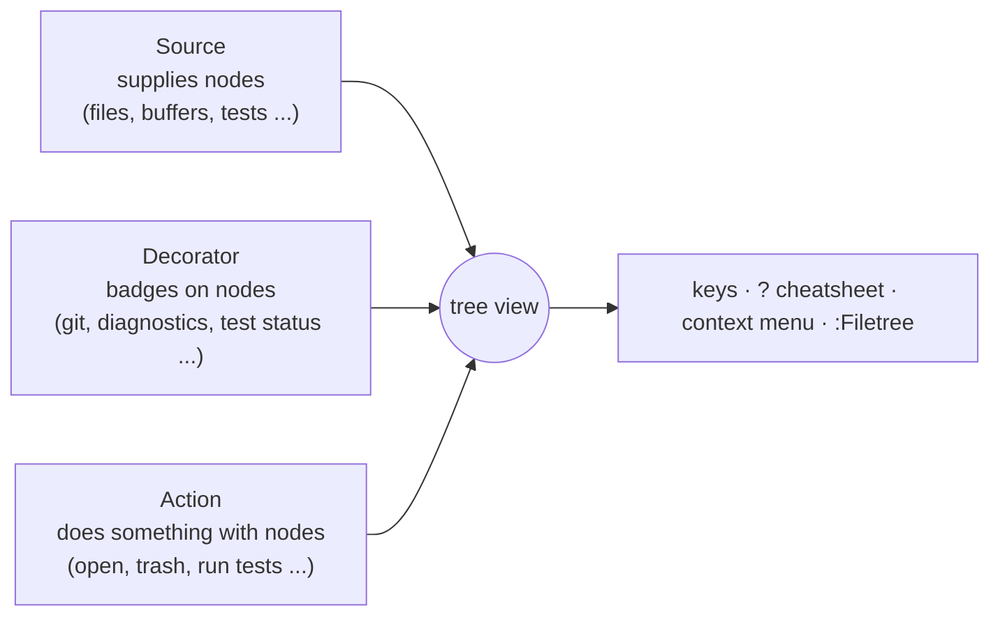
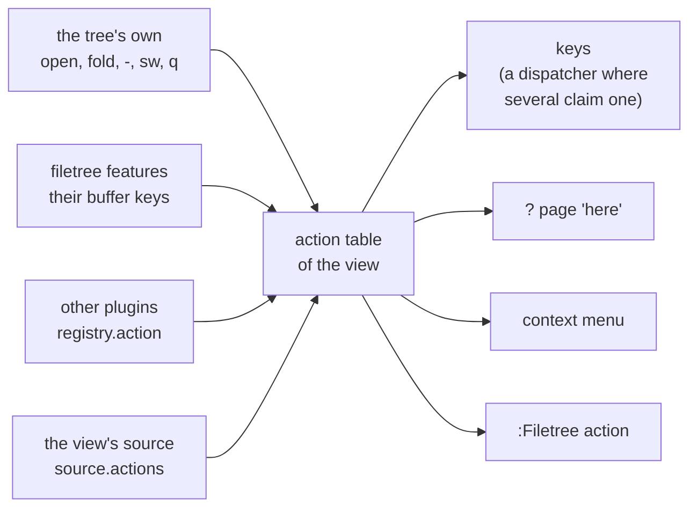

# Public API

```lua
local ft = require("filetree")
ft.setup(config)
ft.adapter()            -- → FiletreeAdapter?
ft.config()             -- → FiletreeConfig
ft.feature("marks")     -- → feature module | nil
ft.register_adapter(a)  -- register custom adapter (before setup)
ft.source(s)            -- register a source, a decorator or an action for the own tree;
ft.decorator(d)         -- each returns an unregister function (see "Sources, decorators
ft.action(a)            -- and actions" below)
ft.is_initialized()     -- → boolean
ft.attach(opts, config) -- deprecated no-op: hands `opts` back untouched (filetree no longer
                        -- writes into neo-tree's window.mappings; the `?` cheatsheet lists the keys)
```

## Reference engine

```lua
local refs = require("filetree.refs")
refs.config()            -- → FiletreeRefsConfig
refs.status()            -- → string[]  (what `:Filetree refs status` prints)
refs.undo()              -- revert the last reference rewrite
refs.register(provider)  -- add a language provider

-- How often is each of these files referenced, and where? One sweep for the
-- whole set (a folder of screenshots), not one scan per path.
refs.usage.count(paths, { root = nil }, function(by_path, meta)
  -- by_path[path] = { count = n, refs = FiletreeRef[], files = string[] }
  -- meta = { providers = string[], files_scanned = n, cancelled = boolean }
end)
```

Driving it from your own file operation is a three-step contract — scan
before the mutation, mutate, then hand the result back:

```lua
local handle = refs.prefetch({ old_path }, { op = "move" })
handle.await(function(result)
  -- the scan is finished and saw the file at its OLD path
  do_the_move()
  refs.handle_result(result, { [old_path] = new_path }, { op = "move" })
end)
```

## Custom reference providers

```lua
require("filetree.refs").register({
  name = "rust",
  plan = function(old_path, ctx)      -- ctx = { root, is_dir, cfg }
    return {                          -- return nil to sit this one out
      needles    = { "…" },           -- fixed strings for the ripgrep pre-filter
      extensions = { "rs" },          -- files that may hold such a reference
      extract    = function(file, lineno, text) return { --[[ FiletreeRef… ]] } end,
      retarget   = function(ref, new_path) return "…" end,
    }
  end,
})
```

See [`lua/filetree/@types/refs.lua`](../lua/filetree/@types/refs.lua) for the
full annotated contract and
[`lua/filetree/refs/providers/`](../lua/filetree/refs/providers/) for the four
built-in implementations.

## Name suggestions for the create prompt

A plugin can pre-fill the name `smart_create` (`a`) asks for, for the folders it
knows. The first provider that answers wins; the prompt stays editable.

```lua
require("filetree.create_names").register("casedesk", function(dir)
  -- dir: the folder the new entry goes into, `/`-separated, no trailing slash
  if dir:match("/assets$") then return "03_2026-10-19/" end -- trailing / = a folder
end)
```

`unregister(id)` removes a provider, `suggest(dir)` asks them. Registering works
before or after `filetree.setup()`; a provider that raises is skipped.

## Root providers

A plugin can say which directory is the root for the files it knows, ahead of
the `.git` walk: a case folder inside a larger repository, say. `cwd_mode` asks
the providers first in every mode (so `project` holds that folder), and
`util.target_dir` asks them too, so they apply with cwd_mode off as well; the
cwd cwd_sync moves to and the root the tree is shown at follow from that. A
pinned root (`lock`, `manual`) still wins.

```lua
require("filetree.roots").register("casedesk.case", function(path)
  -- path: a file or a directory; return a directory, or nil to stay out of it
  local case = require("casedesk.registry").owning(path)
  return case and case.dir or nil
end)
```

The first provider with an answer wins, in registration order; a provider that
raises, or answers with something that is not an existing directory, is
skipped. `unregister(id)` removes one, `resolve(path)` asks them, `any()` says
whether one is registered. Registering works before or after `filetree.setup()`.

## Sources, decorators and actions (the own tree)

> **Being built.** filetree.nvim is getting a tree of its own (backend
> `native`) next to the five tree plugins it drives today. This section is its
> contract, and the registration below works now; the window that reads these
> entries arrives with the next stages. Until then a registered entry is stored
> and nothing draws it.

The own tree keeps three things apart that a tree plugin usually packs into one
"source":



| | What it is | Must carry | You need one when |
| --- | --- | --- | --- |
| **Source** | the nodes of one view | `name`, `root()` | you have a tree of your own to show |
| **Decorator** | a badge per path or node id | `name`, `get()`, `subscribe()` | you know something about files that should show next to them, in every view |
| **Action** | a key, a menu entry, a command | `name`, `run()` | something can be done with a node |

Most integrations need no source: a status next to files is a decorator, a
command on a file is an action.

### Registering

```lua
local ft = require("filetree")

local remove = ft.decorator({ name = "todo_count", get = ..., subscribe = ... })
ft.source({ ... })
ft.action({ ... })
remove() -- takes the entry out again

-- or with setup(); a later setup() replaces what an earlier one listed
ft.setup({
  sources = { ... },
  decorators = { ... },
  actions = { ... },
})
```

`require("filetree.registry")` is the same three functions plus `list(kind)`,
`get(kind, name)` and `subscribe(fn)`. Registering works before or after
`setup()`. A second registration under the same name replaces the first; an
entry that lacks a required function is refused with an error that names the
call.

### A node with a `path` is a file everywhere

A node is `{ id, label, kind?, status?, icon?, columns?, children?, path?, data? }`.
`children` is a list, or `function(node, cb)` that answers `cb(list)` or
`cb(nil, err)` when the node is first opened. Give a node a `path` and it is a
file or a folder for the rest of the plugin, whichever source it came from:
file actions apply to it and path decorators find it. `data` belongs to you.

### A source

A tree that is not a directory, in under 40 lines:

<!-- example:source -->
```lua
local filetree = require("filetree")

local lists = {
  { name = "today", items = { { title = "Call the bank", file = "/notes/bank.md" } } },
  { name = "later", items = { { title = "Read the docs", file = "/notes/docs.md" } } },
}

filetree.source({
  name = "todo",
  title = "Todo",
  icon = "\u{f0ae}", -- optional: the tab of the view in the bar, with a Nerd Font
  root = function()
    return {
      id = "todo:root",
      label = "Todo",
      children = function(_, cb)
        cb(vim.tbl_map(function(list)
          return {
            id = "todo:" .. list.name,
            label = list.name,
            kind = "group",
            columns = { tostring(#list.items) },
            children = function(_, cb_items)
              cb_items(vim.tbl_map(function(item)
                return { id = "todo:" .. item.file, label = item.title, kind = "todo", path = item.file }
              end, list.items))
            end,
          }
        end, lists))
      end,
    }
  end,
  actions = {
    { name = "todo.done", key = "gd", desc = "Mark as done", needs = { "kind:todo" }, run = function(nodes) end },
  },
})
```

Because the leaves carry a `path`, opening them, the preview, path copies and
every path decorator work on them without another line.

Optional fields of a source: `title`, `icon`, `children(node, ctx, cb)` (lazy
children for nodes that carry none), `subscribe(ctx, emit)` (live updates while
a view shows the source: `emit.push(update)`, `emit.invalidate(id)`,
`emit.reset()`; return an unsubscribe function), `actions`, `severity` and
`aggregate` (how statuses add up on a parent), `preview(node, ctx)` (what the
[preview](#a-previewer) shows for one of its nodes),
`available()` (answer `false, reason` when the source cannot load right now),
`mutable = false` (actions that need `"mutable"` step back on its nodes).

A registered source is a view of the tree window: a tab of its
[view bar](FEATURES/BACKENDS.md#views-and-sources), reachable with `"` / `!`
and `:Filetree source <name>`, and usable as a section through `native.views`.
`root(ctx)` is called when the view is shown, with
`ctx = { root, cwd, win, view, source, alt_buf }` (`view`: the name of the
view; `alt_buf`: the editor buffer the tree belongs to); `subscribe` runs only
while the window is on screen. An action's `run(nodes, ctx)` and `when(node,
ctx)` get the same fields and two more: `ctx.mutable`, and `ctx.tree`, the tree
view itself (`ctx.tree:refresh()` after the action changed what the view
shows).

What a node may carry besides `id`, `label`, `kind`, `status`, `columns`,
`children`, `path` and `data`:

| Field | Effect |
| --- | --- |
| `open = true` | the node starts open, once; closed by hand it stays closed |
| `hl = "<group>"` | the highlight group of its name |
| `icon = "<glyph>"` | drawn in place of the file icon |
| `lazy = true` | its children come from the source's `children(node, ctx, cb)` |
| `kind = "note"` | a line of text and no entry ("nothing changed") |
| `data.bufnr` | `<CR>` shows this buffer instead of a file (a terminal) |
| `data.lnum`, `data.col` | `<CR>` goes there (1-based line, 0-based column) |

`columns` are drawn at the far right of the line. The number next to a view in
the bar is how many of its nodes carry a `status`.

`emit` has a fourth function on this tree: `emit.focus(id)` puts the cursor of
the tree on one of the source's nodes and opens what is above it (the symbols
view follows the editor's cursor with it); it does nothing while the user is in
the tree window. After `emit.reset()` and `emit.invalidate(id)` the nodes are
merged by `id`: a node that is there again keeps its place, its open state and
the cursor, so give a node the same `id` every time.

### A decorator

```lua
filetree.decorator({
  name = "tests",
  key = "path",        -- what get() is asked with: "path" (default) or "id"
  slot = "badge",      -- "name" | "sign" | "badge" | "column" | "line"
  priority = 50,       -- higher keeps its place longer in a narrow window
  roll_up = "worst",   -- how it shows on a folder: "worst" | "count" | "any" | false
  severity = { "failed", "running", "passed" },
  get = function(path) return cache[path] end,               -- { text?, hl?, status?, count? }
  all = function() return cache end,                          -- optional: every key that has a badge
  subscribe = function(emit) return store.on_change(emit) end, -- emit({ path, ... }) or emit() for all
})
```

`get` runs while the tree draws. It has to be a table lookup: no file access,
no process. Do the work when your data changes and tell the tree through
`emit` which keys to redraw.

With `roll_up` set, a folder shows what lies below it: the worst status (in the
order of `severity`), how many paths carry a badge (`"count"`), or any of them.
The tree adds that up from the keys you emit and from `all()`; give it `all()`
and a folder that was never opened shows its badge too. A decorator that raises
is switched off for the session and named once.

**Which folder to look at.** A decorator that finds its badges by a scan
(which images no document refers to, which recordings have a transcript) scans
what the tree shows, not the working directory. `subscribe` is handed a second
argument for that, and an event says when it changes:

```lua
subscribe = function(emit, ctx)
  local function rescan()
    for _, root in ipairs(ctx and ctx.roots() or { vim.fn.getcwd() }) do
      scan(root, emit)                   -- in the background; emit the paths that changed
    end
  end
  local id = vim.api.nvim_create_autocmd("User", { pattern = "FiletreeRoots", callback = rescan })
  rescan()
  return function() vim.api.nvim_del_autocmd(id) end
end
```

`ctx.roots()` answers the roots the trees show right now (one per tab that
opened one, sorted). `User FiletreeRoots` fires with `data.roots` when a tree
is made, rooted elsewhere or given up, and only when the list is another one.
A decorator registered without `ctx` in its signature works as before.

`get` is also handed the node of the row being drawn (`get(key, node)`), for what is a
property of the node and not of its path, a symlink for one. It is not handed
one when a key you emitted is read again.

Slots: `badge` and `column` stand right of the name (a column gives way first
when the window is narrow, then the badge with the lowest `priority`), `name`
lays `hl` over the name, `line` over the whole line, `sign` puts `text` in the
first cell of the line (the tree has no sign column; the root line shows none).
Badges stand next to the name, columns at the far right.

### An action

```lua
filetree.action({
  name = "notes.archive",
  key = "ga",
  desc = "Archive this note",
  needs = { "file" },          -- "path" | "file" | "dir" | "mutable" | "kind:<k>" | "source:<s>"
  when = function(node, ctx) return node.path:match("%.md$") ~= nil end, -- what `needs` cannot say
  mutates = true,              -- it changes files
  args = { where = { values = { "year", "month" }, default = "year" } },
  ai = false,                  -- optional: keep it out of the catalog of native.ai
  run = function(nodes, ctx, args) ... end,
})
```

`args` and `mutates` are also what the tree tells a model when it is asked in
words ([native.ai](FEATURES/AI.md)): a value outside `values` is refused before
`run` is called, and an action runs there without the question only when it
says `mutates = false`; one with `mutates = true`, or without the field, runs
only after the person said yes to the plan. `ai = false` leaves the action out
of that catalog.

An action says itself where it applies. On a node where it does not, its key
falls through to the next action bound to that key, and when none applies the
tree says why instead of doing nothing. `run` gets a list: the selection, or
the node under the cursor.



Which action a key runs, first wins: an action of the view's source, then the
higher `priority` (default 0), then a filetree feature before another plugin's
action before the tree's own, then the order of registration. A key that only a
feature claims keeps that feature's mapping; a key the user or another plugin
mapped on the tree buffer is left alone. An action that presses its own key while
it runs (a feature wrapping what was on the key before it) reaches the next
action of that key, not itself.

So a key a filetree feature already has (`gs` live search, `D` diff, `m`
mark, and the others in [Keymaps](keymaps.md)) wins over an action another
plugin registers on it (at the same `priority`): that action runs only on a node
where the feature does not apply. A plugin that names a key for its action in its docs therefore
names a leader key (`<leader>dc`), not a free-looking letter of the tree
buffer.

### A previewer

The preview (`<Tab>`, [features](FEATURES/UI.md)) shows the file of a node.
Two kinds of node have something better to show, and both say so here.

**A node of your source that is no file** (a failed test case, a pipeline
step): the source carries `preview(node, ctx)` and answers what to show, or
`nil` for "the file of the node, as always":

```lua
preview = function(node, ctx)
  local case = cases[node.id]
  if not case or not case.output then return nil end
  return { lines = case.output, filetype = "diff", title = case.name }
end
```

**A file your plugin can draw** (a frame of a video, the waveform of a
recording): register a previewer. It is asked for every node, also for the
files of the directory tree, and with every backend:

```lua
require("filetree").previewer({
  name = "media",
  priority = 0,                         -- the highest that matches is asked
  match = function(node)                -- table lookups only: runs on every cursor move
    return node.path ~= nil and VIDEO[node.path:match("%.(%w+)$") or ""] == true
  end,
  preview = function(node, ctx, done)   -- returns at once
    local job = frames.extract(node.path, function(png, err)
      if png then done({ image = png, title = node.label }) else done(nil, err) end
    end)
    return function() job:kill() end    -- optional: nobody waits any more
  end,
})
```

`ctx` is the [context](#registering) of the view plus `mode` (`"float"` or
`"buffer"`, `features.preview.mode`), `trigger` (`"toggle"`: `<Tab>` was
pressed; `"cursor"`: the cursor moved while a preview is shown), `width` and
`height` (what the preview may use).

The answer, from a source or through `done` (once, now or later), is one of:

| Answer | Shown as |
| --- | --- |
| `{ lines = { ... }, filetype?, title? }` | the lines, in the float or in a scratch buffer in the editor window |
| `{ image = "/abs/frame.png", title? }` | on `<Tab>` the image viewer shows it, as if the node were that image; while the cursor moves only the title is shown (no viewer per line) |
| `{ note = "ffmpeg not found" }`, or `done(nil, "ffmpeg not found")` | that one line; no warning |

An answer for a node the cursor has left is dropped, and the previewer that
was still working is told (the function it returned). `<Tab>` on the node
whose preview is shown takes it away again. A previewer or a `preview` of a
source that raises is named once and not asked again. A file nobody claims is
previewed as before; `<CR>` is not touched.

Registering one level lower works here too
(`require("lib.nvim.tree.registry").previewer({ ... })`), and `setup()` takes
`previewers = { ... }` next to `sources`, `decorators` and `actions`.

### When files changed

Every finished file operation of filetree.nvim fires
`User FiletreeChanged` with `data = { op, from, to }` (`op`: `"create"`,
`"move"`, `"copy"`, `"delete"`; a rename is a move). Whoever shows files can
react to exactly that: the own tree reads the folders `from` and `to` lie in,
nothing else. Announce your own operation the same way:

```lua
require("filetree.util.changed").emit("create", nil, "/abs/path/new.lua")
```

While the own tree shows a view of other sources, the event asks the sources
of that view again (once for however many operations ended together). A
[source](#a-source) that lists files therefore needs no events of its own to be
right after a rename or a delete done from its view; one that changes for other
reasons still has `emit`.

The types are in
[`lua/filetree/@types/native.lua`](../lua/filetree/@types/native.lua).

### The state of the file layer

What the own tree holds on the disk, as plain data: for a debug command, a
health check, or the question "is a handle of this Neovim what keeps the
folder busy?". Reading it starts nothing and changes nothing; the table is a
copy.

```lua
local state = require("filetree").fs_state()
```

| Field | What it says |
| --- | --- |
| `active` | the own tree is the active backend (`adapter = "native"`); `false`: the lists below are empty unless a tree was opened before the backend changed |
| `watch` | `native.watch`; `false`: the tree does not follow the disk and holds no handle |
| `recursive` | one handle per root watches everything below it (Windows, macOS); `false`: one handle per folder read |
| `watchers` | `{ dir, refs, error? }[]`, sorted by folder: the open `fs_event` handles; `refs` counts who asked for the folder |
| `released` | `{ dir, refs }[]`: handles closed for a running file operation, opened again after it |
| `quarantined` | folders held back after an event storm (more than 200 events a second), reported once they went quiet |
| `changed` | folders whose listing changed and that are not reported yet (the short quiet before a report) |
| `reading` | folders being read right now |
| `folders` | `{ fresh, loading, dirty, error, errors }`: how many folders the tree asked for have a cached listing, are being read, changed and were not read again yet, or failed; `errors` is `{ dir, error }[]`, sorted, with the reason |
| `roots` | the roots of the trees there are, one per tab that opened one |
| `stats` | `{ events, reports, quarantined }`, counted since Neovim started |

A folder is covered by a handle when it is in `watchers`, or, with
`recursive`, when it lies below a folder of `watchers`. Paths are normalized
(forward slashes, as the tree writes them).

### The tree in your own window

A plugin that wants the picture of the directory tree in a window of its own
(a hover float, a side panel) asks for the layout `embed`:

```lua
local tree, err = require("filetree.native").embed(buf, "/path/to/dir", {
  show_root = false,   -- the folder itself as the first row
  icons = true,        -- drawn only with a Nerd Font declared
  max_entries = 200,   -- per folder; a last line says how many more (0 = no limit)
  group_empty = true,  -- a/b/c as one line
  sort = { kind = "name" },
  hide = nil,          -- fun(name, path): boolean
  watch = false,       -- follow the disk until close()
  select = true,       -- keep a selection and highlight its line (FiletreeEmbedSelection)
  on_change = nil,     -- fun(handle): the lines were written again (fit your window here)
})
```

`buf` is yours and stays yours: the embed writes its lines and highlights and
nothing else. It maps no key, creates no autocmd, sets no option of any
window, and opens none; whether the float is focusable is your business. The
first argument may also be a table (`{ buf = b, root = dir, ... }` or
`{ win = w, root = dir }`). It works without `setup()` and with any backend.
`err` says why there is no handle (no such buffer, not a directory).

| On the handle | Does |
| --- | --- |
| `tree:move(delta)` | move the selection by rows, stopping at the ends; returns the row |
| `tree:select(line_or_path)` | put the selection on a line or on the row of a path; `nil` for a path that is no row |
| `tree:current()` | the row of the selection: `{ id, path, kind, label, line, expandable, expanded }` |
| `tree:expand(path?)` / `tree:collapse(path?)` / `tree:toggle(path?)` | open or close a folder (default: under the selection); `false` when nothing changed |
| `tree:rows()` | every row on screen, top to bottom |
| `tree:refresh()` | read the folders again; open folders and the selection stay |
| `tree:close()` | give the watcher handles back and clear the highlights; safe twice. The buffer keeps its lines |

`kind` is `"dir"`, `"file"`, or `"more"` for the line that counts what
`max_entries` left out. That row has no `path`; it carries `dir`, the folder
whose entries it counts, and `more`, how many it stands for (its `id` is not
part of the contract). Folders are read when they are
opened, at once, so `rows()` right after `expand()` has the new rows.

### For plugin authors: registering without loading filetree.nvim

`require("filetree")` from another plugin makes a plugin manager load
filetree.nvim on the spot. A plugin that only wants to announce a decorator
when it starts can register one level lower, where nothing is loaded and
nothing has to be installed:

```lua
local ok, registry = pcall(require, "lib.nvim.tree.registry")
if ok then registry.decorator({ ... }) end
```

It is the same list; `filetree.registry` is a thin re-export of it.

## Custom adapters

```lua
require("filetree").register_adapter({
  name             = "my_tree",
  is_available     = function() return true end,
  is_open          = function() return false, nil end,
  get_winid        = function() return nil end,
  get_root_path    = function() return nil end,
  get_current_node = function() return nil end,
  get_visible_nodes= function(_f) return {} end,
  get_node_line    = function(_p) return nil end,
  expand_node      = function(_n) return false end,
  collapse_node    = function(_n) return false end,
  open_file        = function(_p,_m) return false end,
  open_reveal      = function(_p,_l) return false end,
  open_cwd         = function() return false end,
  close            = function() return false end,
  refresh          = function() return false end,
  scroll_to_line   = function(_l) return false end,
  highlight_node   = function(_p,_h) return false end,
  unhighlight_node = function(_p) return false end,
})
require("filetree").setup({ adapter = "my_tree" })
```

See [`lua/filetree/@types/adapter.lua`](../lua/filetree/@types/adapter.lua) for the full annotated interface.
