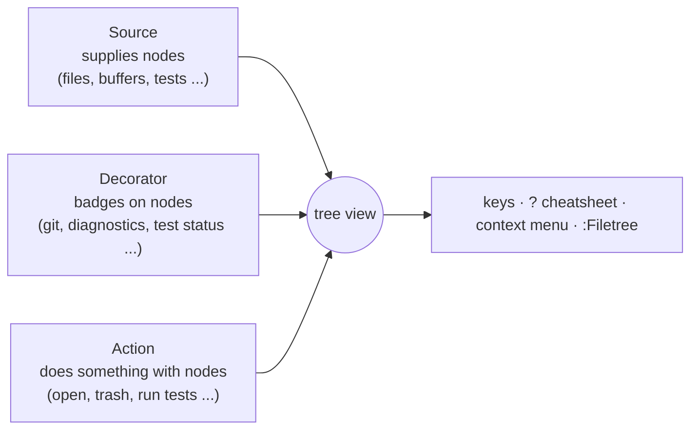

# Public API

```lua
local ft = require("filetree")
ft.setup(config)
ft.adapter()            -- → FiletreeAdapter?
ft.config()             -- → FiletreeConfig
ft.feature("marks")     -- → feature module | nil
ft.register_adapter(a)  -- register custom adapter (before setup)
ft.source(s)            -- register a source, a decorator or an action for the own tree;
ft.decorator(d)         -- each returns an unregister function (see "Sources, decorators
ft.action(a)            -- and actions" below)
ft.is_initialized()     -- → boolean
ft.attach(opts, config) -- deprecated no-op: hands `opts` back untouched (filetree no longer
                        -- writes into neo-tree's window.mappings; the `?` cheatsheet lists the keys)
```

## Reference engine

```lua
local refs = require("filetree.refs")
refs.config()            -- → FiletreeRefsConfig
refs.status()            -- → string[]  (what `:Filetree refs status` prints)
refs.undo()              -- revert the last reference rewrite
refs.register(provider)  -- add a language provider

-- How often is each of these files referenced, and where? One sweep for the
-- whole set (a folder of screenshots), not one scan per path.
refs.usage.count(paths, { root = nil }, function(by_path, meta)
  -- by_path[path] = { count = n, refs = FiletreeRef[], files = string[] }
  -- meta = { providers = string[], files_scanned = n, cancelled = boolean }
end)
```

Driving it from your own file operation is a three-step contract — scan
before the mutation, mutate, then hand the result back:

```lua
local handle = refs.prefetch({ old_path }, { op = "move" })
handle.await(function(result)
  -- the scan is finished and saw the file at its OLD path
  do_the_move()
  refs.handle_result(result, { [old_path] = new_path }, { op = "move" })
end)
```

## Custom reference providers

```lua
require("filetree.refs").register({
  name = "rust",
  plan = function(old_path, ctx)      -- ctx = { root, is_dir, cfg }
    return {                          -- return nil to sit this one out
      needles    = { "…" },           -- fixed strings for the ripgrep pre-filter
      extensions = { "rs" },          -- files that may hold such a reference
      extract    = function(file, lineno, text) return { --[[ FiletreeRef… ]] } end,
      retarget   = function(ref, new_path) return "…" end,
    }
  end,
})
```

See [`lua/filetree/@types/refs.lua`](../lua/filetree/@types/refs.lua) for the
full annotated contract and
[`lua/filetree/refs/providers/`](../lua/filetree/refs/providers/) for the four
built-in implementations.

## Name suggestions for the create prompt

A plugin can pre-fill the name `smart_create` (`a`) asks for, for the folders it
knows. The first provider that answers wins; the prompt stays editable.

```lua
require("filetree.create_names").register("casedesk", function(dir)
  -- dir: the folder the new entry goes into, `/`-separated, no trailing slash
  if dir:match("/assets$") then return "03_2026-10-19/" end -- trailing / = a folder
end)
```

`unregister(id)` removes a provider, `suggest(dir)` asks them. Registering works
before or after `filetree.setup()`; a provider that raises is skipped.

## Root providers

A plugin can say which directory is the root for the files it knows, ahead of
the `.git` walk: a case folder inside a larger repository, say. `cwd_mode` asks
the providers first in every mode (so `project` holds that folder), and
`util.target_dir` asks them too, so they apply with cwd_mode off as well; the
cwd cwd_sync moves to and the root the tree is shown at follow from that. A
pinned root (`lock`, `manual`) still wins.

```lua
require("filetree.roots").register("casedesk.case", function(path)
  -- path: a file or a directory; return a directory, or nil to stay out of it
  local case = require("casedesk.registry").owning(path)
  return case and case.dir or nil
end)
```

The first provider with an answer wins, in registration order; a provider that
raises, or answers with something that is not an existing directory, is
skipped. `unregister(id)` removes one, `resolve(path)` asks them, `any()` says
whether one is registered. Registering works before or after `filetree.setup()`.

## Sources, decorators and actions (the own tree)

> **Being built.** filetree.nvim is getting a tree of its own (backend
> `native`) next to the five tree plugins it drives today. This section is its
> contract, and the registration below works now; the window that reads these
> entries arrives with the next stages. Until then a registered entry is stored
> and nothing draws it.

The own tree keeps three things apart that a tree plugin usually packs into one
"source":



| | What it is | Must carry | You need one when |
| --- | --- | --- | --- |
| **Source** | the nodes of one view | `name`, `root()` | you have a tree of your own to show |
| **Decorator** | a badge per path or node id | `name`, `get()`, `subscribe()` | you know something about files that should show next to them, in every view |
| **Action** | a key, a menu entry, a command | `name`, `run()` | something can be done with a node |

Most integrations need no source: a status next to files is a decorator, a
command on a file is an action.

### Registering

```lua
local ft = require("filetree")

local remove = ft.decorator({ name = "todo_count", get = ..., subscribe = ... })
ft.source({ ... })
ft.action({ ... })
remove() -- takes the entry out again

-- or with setup(); a later setup() replaces what an earlier one listed
ft.setup({
  sources = { ... },
  decorators = { ... },
  actions = { ... },
})
```

`require("filetree.registry")` is the same three functions plus `list(kind)`,
`get(kind, name)` and `subscribe(fn)`. Registering works before or after
`setup()`. A second registration under the same name replaces the first; an
entry that lacks a required function is refused with an error that names the
call.

### A node with a `path` is a file everywhere

A node is `{ id, label, kind?, status?, icon?, columns?, children?, path?, data? }`.
`children` is a list, or `function(node, cb)` that answers `cb(list)` or
`cb(nil, err)` when the node is first opened. Give a node a `path` and it is a
file or a folder for the rest of the plugin, whichever source it came from:
file actions apply to it and path decorators find it. `data` belongs to you.

### A source

A tree that is not a directory, in under 40 lines:

<!-- example:source -->
```lua
local filetree = require("filetree")

local lists = {
  { name = "today", items = { { title = "Call the bank", file = "/notes/bank.md" } } },
  { name = "later", items = { { title = "Read the docs", file = "/notes/docs.md" } } },
}

filetree.source({
  name = "todo",
  title = "Todo",
  root = function()
    return {
      id = "todo:root",
      label = "Todo",
      children = function(_, cb)
        cb(vim.tbl_map(function(list)
          return {
            id = "todo:" .. list.name,
            label = list.name,
            kind = "group",
            columns = { tostring(#list.items) },
            children = function(_, cb_items)
              cb_items(vim.tbl_map(function(item)
                return { id = "todo:" .. item.file, label = item.title, kind = "todo", path = item.file }
              end, list.items))
            end,
          }
        end, lists))
      end,
    }
  end,
  actions = {
    { name = "todo.done", key = "gd", desc = "Mark as done", needs = { "kind:todo" }, run = function(nodes) end },
  },
})
```

Because the leaves carry a `path`, opening them, the preview, path copies and
every path decorator work on them without another line.

Optional fields of a source: `title`, `icon`, `children(node, ctx, cb)` (lazy
children for nodes that carry none), `subscribe(ctx, emit)` (live updates while
a view shows the source: `emit.push(update)`, `emit.invalidate(id)`,
`emit.reset()`; return an unsubscribe function), `actions`, `severity` and
`aggregate` (how statuses add up on a parent), `preview(node, ctx)`,
`available()` (answer `false, reason` when the source cannot load right now).

### A decorator

```lua
filetree.decorator({
  name = "tests",
  key = "path",        -- what get() is asked with: "path" (default) or "id"
  slot = "badge",      -- "name" | "sign" | "badge" | "column" | "line"
  priority = 50,       -- higher keeps its place longer in a narrow window
  roll_up = "worst",   -- how it shows on a folder: "worst" | "count" | "any" | false
  severity = { "failed", "running", "passed" },
  get = function(path) return cache[path] end,               -- { text?, hl?, status?, count? }
  all = function() return cache end,                          -- optional: every key that has a badge
  subscribe = function(emit) return store.on_change(emit) end, -- emit({ path, ... }) or emit() for all
})
```

`get` runs while the tree draws. It has to be a table lookup: no file access,
no process. Do the work when your data changes and tell the tree through
`emit` which keys to redraw.

With `roll_up` set, a folder shows what lies below it: the worst status (in the
order of `severity`), how many paths carry a badge (`"count"`), or any of them.
The tree adds that up from the keys you emit and from `all()`; give it `all()`
and a folder that was never opened shows its badge too. A decorator that raises
is switched off for the session and named once.

Slots: `badge` and `column` stand right of the name (a column gives way first
when the window is narrow, then the badge with the lowest `priority`), `name`
lays `hl` over the name, `line` over the whole line. `sign` stands with the
badges for now.

### An action

```lua
filetree.action({
  name = "notes.archive",
  key = "ga",
  desc = "Archive this note",
  needs = { "file" },          -- "path" | "file" | "dir" | "mutable" | "kind:<k>" | "source:<s>"
  when = function(node, ctx) return node.path:match("%.md$") ~= nil end, -- what `needs` cannot say
  mutates = true,              -- it changes files
  args = { where = { values = { "year", "month" }, default = "year" } },
  run = function(nodes, ctx, args) ... end,
})
```

An action says itself where it applies. On a node where it does not, its key
falls through to the next action bound to that key, and when none applies the
tree says why instead of doing nothing. `run` gets a list: the selection, or
the node under the cursor.

The types are in
[`lua/filetree/@types/native.lua`](../lua/filetree/@types/native.lua).

### For plugin authors: registering without loading filetree.nvim

`require("filetree")` from another plugin makes a plugin manager load
filetree.nvim on the spot. A plugin that only wants to announce a decorator
when it starts can register one level lower, where nothing is loaded and
nothing has to be installed:

```lua
local ok, registry = pcall(require, "lib.nvim.tree.registry")
if ok then registry.decorator({ ... }) end
```

It is the same list; `filetree.registry` is a thin re-export of it.

## Custom adapters

```lua
require("filetree").register_adapter({
  name             = "my_tree",
  is_available     = function() return true end,
  is_open          = function() return false, nil end,
  get_winid        = function() return nil end,
  get_root_path    = function() return nil end,
  get_current_node = function() return nil end,
  get_visible_nodes= function(_f) return {} end,
  get_node_line    = function(_p) return nil end,
  expand_node      = function(_n) return false end,
  collapse_node    = function(_n) return false end,
  open_file        = function(_p,_m) return false end,
  open_reveal      = function(_p,_l) return false end,
  open_cwd         = function() return false end,
  close            = function() return false end,
  refresh          = function() return false end,
  scroll_to_line   = function(_l) return false end,
  highlight_node   = function(_p,_h) return false end,
  unhighlight_node = function(_p) return false end,
})
require("filetree").setup({ adapter = "my_tree" })
```

See [`lua/filetree/@types/adapter.lua`](../lua/filetree/@types/adapter.lua) for the full annotated interface.
